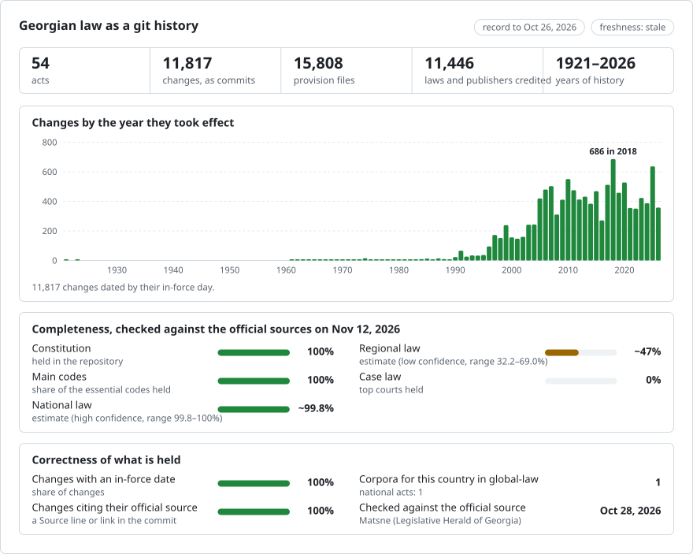

# Georgia: law history in git

**English** · **[ან წაიკითხეთ ქართულად](README.md)**

<picture>
<source media="(prefers-color-scheme: dark)" srcset="data/effort-dark.svg">

</picture>

The law of Georgia as a git history: one file per article, one commit per version on the day it took effect, and the act that made each change as the commit's author. `git blame` names the act behind every article; `git log` lists every change to an article; picking a date gives the text in force that day.

Part of [lexifina/global-law](https://github.com/lexifina/global-law), one git history for every country's law: this is Georgia's national law, which global-law reads at `georgia/national/acts/`.

**What is in it now:** the Constitution (and the 1921 Constitution, as Matsne publishes it) and 946 other acts of Matsne's "law" group, in force or not, with 12,954 consolidated publications: 796 laws, 40 organic laws, 36 codes, 57 laws of the autonomous republics of Adjara and Abkhazia, 4 rules of procedure of Parliament, 1 constitutional law and 12 other acts (Soviet-era decrees and similar). 560 of them are on `main` today; the files of the other 388 were deleted on the day their repeal took effect. [`laws.csv`](laws.csv) lists every act with its title, status and Matsne link.

Each act is in `<kind>/<year>/<number>/`, by the year it was adopted and its number, one file per article (`organic-law/2010/4113-რს/` is the საქართველოს შრომის კოდექსი, the Labour Code of Georgia, Organic Law №4113-რს of 17 December 2010, and `14-1.md` its article 14¹); the Constitution is [`constitution/1995/786/`](constitution/1995/786/). Until 2026-11-10 each folder was named by the act's Matsne id (`organic-law/1155567/`), as `laws.csv` still gives it; `data/paths.json` maps each id to its folder.

The text is in Georgian, as Matsne publishes it. Matsne's unofficial English translations are not part of this record.

## Questions as git commands

| Question | Command |
| --- | --- |
| Every change to Article 1 of the Labour Code | `git log --follow -p --word-diff -- organic-law/2010/4113-რს/1.md` |
| Which act wrote each line of Article 1? | `git blame organic-law/2010/4113-რს/1.md` |
| Every version of the Labour Code, with the day each took effect | `git log --format="%h %(trailers:key=In-force,valueonly,separator=) %an" -- organic-law/2010/4113-რს organic-law/1155567` |
| Article 1 as in force on 1 January 2015 | `python tools/in_force_on.py 2015-01-01 organic-law/1155567 1` |

**Outside git**, we also host this record publicly, for free:

- **[Ask Claude about Georgian law](https://global-law.lexifina.com/v1/try_claude?country=georgia)**: opens Claude with a first question ready.
- **[Ask ChatGPT](https://global-law.lexifina.com/v1/try_chatgpt?country=georgia)**: the same question in ChatGPT.
- **[Search Georgian law on our site](https://lexifina.com/law?country=georgia&q=%E1%83%A8%E1%83%95%E1%83%94%E1%83%91%E1%83%A3%E1%83%9A%E1%83%94%E1%83%91%E1%83%90)**: a search for "შვებულება" (leave), with each provision's text and its versions, no account needed.
- **[Developer REST API](https://global-law.lexifina.com/v1/search_law?query=%E1%83%A8%E1%83%95%E1%83%94%E1%83%91%E1%83%A3%E1%83%9A%E1%83%94%E1%83%91%E1%83%90&jurisdiction=georgia)**: the same search as JSON, with no key. See the [documentation here](https://lexifina.com/api/global-law).

Both assistants read the record through the free Global law connector (MCP, `https://global-law.lexifina.com/mcp`); the first time, the chat gives you the link that adds it. Ask in Georgian or in English.

**Host it yourself easily.** All it takes is git and Python, and the tools run on your machine:

```sh
git clone --depth 1 https://github.com/lexifina/global-law && cd global-law
python3 tools/countries.py add georgia/national/acts
python3 tools/law.py show 2026-01-01 georgia/national/acts/organic-law/2010/4113-რს/1.md
```

Opened in Claude Code, Cursor, VS Code or Codex, the clone also starts a local MCP server with the same tools ([MCP.md](https://github.com/lexifina/global-law/blob/main/MCP.md)).

## Dates

Each commit is dated at noon, Asia/Tbilisi, on the day the version took effect, and carries it in its `In-force:` trailer. Matsne dates its consolidated publications by the day the amending act was adopted; the day used here comes from the amending act's own in-force article:

- "on publication": the day it was published; "on the Nth day from publication": that day plus N days; a date in the act: that date;
- an event rather than a date, or no in-force article: the day it was published, labelled `In-force-basis: published (...)` with the act's words quoted;
- where parts of an act take effect later, the commit is dated by its main clause and lists them as `In-force-part:` lines, and its text already includes them, as Matsne's consolidated text does;
- git cannot store dates before 1970, so the 32 earlier commits are dated 1970-01-01, one second apart, with the real day in `In-force:`. Ask for a date with `tools/in_force_on.py`, not `git log --before`.

Each change is credited to the act that made it, as Matsne lists it (`საქართველოს კანონი №4906 (28.06.2019)`), from Matsne's list of changes for each law; no change is left uncredited. The first commit of a law is the law as adopted (Matsne's publication 0), credited to the law itself. Changes published but due to take effect after 2026-10-28 are on the branch `future`, which is never merged.

## How it is checked

- Replaying every change of a law gives Matsne's latest publication of it, for every law; no publication was unreadable (`data/issues.csv` is empty).
- The build is deterministic: the same pages give the same commit hashes, and the sha256 of every page read is in `data/page-sha256.tsv`. See [`REPRODUCE.md`](REPRODUCE.md).
- History is append-only: no merge commits, no rewriting, and every commit's trailers parse with `git interpret-trailers --parse`.

## What it does not show

- **Sub-legislative acts** (Presidential decrees, Government resolutions, ministerial orders: about 50,000 more documents on Matsne), treaties and court decisions, except as amending acts: a Constitutional Court decision that strikes down a provision is credited as the act that changed the text.
- **Some repeals.** 54 laws Matsne marks as no longer in force are left as last published, because Matsne lists no repealing act as their last change (see `status` in `laws.csv`).
- **Transitional rules**, which stay in the amending act at each commit's `Source:` link.
- **Images and layout.** Footnotes, tables drawn as images and formatting are not in the files; other tables are kept as rows, with cells separated by `|`.

## Sources

| Source | Kind | Past versions | Notes |
| --- | --- | --- | --- |
| [Matsne](https://matsne.gov.ge) (Legislative Herald of Georgia) | Official publisher of Georgian legislation | yes, every consolidated publication of each law | Each law's list of changes links the amending act; the acts' own in-force articles give the days |

## Licence

See [`LICENSE`](LICENSE). Under article 8 of the Law of Georgia on Copyright and Related Rights, official documents (laws, other normative acts and their official translations) are not objects of copyright; the texts are reproduced without change to their wording. Lexifina's own contributions (tools, file arrangement, commit messages and documentation) are CC0 1.0.

No AI model wrote or changed legal text; the scripts were written by an AI model, and no model runs while the record is fetched, parsed or built (see [`REPRODUCE.md`](REPRODUCE.md)).

## More

From [lexifina/global-law](https://github.com/lexifina/global-law):

- [FEATURES.md](https://github.com/lexifina/global-law/blob/main/FEATURES.md): every feature, and what every corpus must support (`git blame`, `law.py`, the MCP tools)
- [FAQ.md](https://github.com/lexifina/global-law/blob/main/FAQ.md): questions and answers · [CONTRIBUTING.md](https://github.com/lexifina/global-law/blob/main/CONTRIBUTING.md): proposing changes · [MCP.md](https://github.com/lexifina/global-law/blob/main/MCP.md): the MCP server · [REPRODUCE.md](https://github.com/lexifina/global-law/blob/main/REPRODUCE.md): how it was built · [CHANGELOG.md](https://github.com/lexifina/global-law/blob/main/CHANGELOG.md)
- [FRESHNESS.md](https://github.com/lexifina/global-law/blob/main/FRESHNESS.md): how current each corpus is · [Monitoring](https://github.com/lexifina/global-law/tree/main/monitoring): whether updates are running · [WATCHING.md](https://github.com/lexifina/global-law/blob/main/WATCHING.md): how each official source is watched for changes
- [performance/](https://github.com/lexifina/global-law/tree/main/performance): how fast the tools are, measured
- [visualisations/](https://github.com/lexifina/global-law/tree/main/visualisations): charts and bridges across the world's law
- [Vulnerabilities](https://github.com/lexifina/global-law/tree/main/vulnerabilities): mistakes in legislation as published
