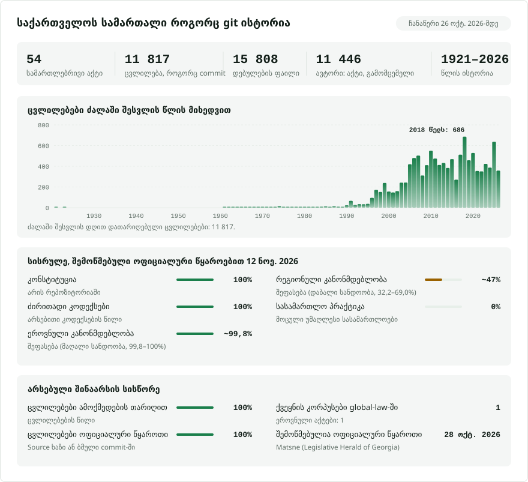

# საქართველო: სამართლის ისტორია git-ში

**ქართული** · **[Or read it in English](README.en.md)**

<picture>
<source media="(prefers-color-scheme: dark)" srcset="data/ka/effort-dark.svg">

</picture>

საქართველოს სამართალი git-ისტორიის სახით: თითო ფაილი თითოეული მუხლისთვის, თითო კომიტი თითოეული ვერსიისთვის იმ დღეს, როდესაც ის ძალაში შევიდა, და კომიტის ავტორად ის აქტი, რომელმაც ცვლილება შეიტანა. `git blame` ასახელებს აქტს, რომელიც თითოეული მუხლის უკან დგას; `git log` ჩამოთვლის მუხლის ყველა ცვლილებას; თარიღის არჩევა იძლევა იმ დღეს მოქმედ ტექსტს.

ეს რეპოზიტორია [lexifina/global-law](https://github.com/lexifina/global-law)-ის ნაწილია, რომელიც ყველა ქვეყნის სამართლის ერთიანი git-ისტორიაა: აქ არის საქართველოს ეროვნული სამართალი, რომელსაც global-law კითხულობს საქაღალდიდან `georgia/national/acts/`.

**რას შეიცავს ახლა:** კონსტიტუციას (და 1921 წლის კონსტიტუციას, როგორც მას მაცნე აქვეყნებს) და მაცნეს „კანონის“ ჯგუფის 946 სხვა აქტს, ძალაშია თუ არა, 12 954 კონსოლიდირებული პუბლიკაციით: 796 კანონი, 40 ორგანული კანონი, 36 კოდექსი, აჭარისა და აფხაზეთის ავტონომიური რესპუბლიკების 57 კანონი, პარლამენტის 4 რეგლამენტი, 1 კონსტიტუციური კანონი და 12 სხვა აქტი (საბჭოთა პერიოდის დეკრეტები და მსგავსი). მათგან 560 დღეს `main`-ზეა; დანარჩენი 388-ის ფაილები წაიშალა იმ დღეს, როდესაც მათი გაუქმება ძალაში შევიდა. [`laws.csv`](laws.csv) ჩამოთვლის ყველა აქტს მისი სათაურით, სტატუსითა და მაცნეს ბმულით.

თითოეული აქტი არის საქაღალდეში `<kind>/<year>/<number>/`, მიღების წლისა და ნომრის მიხედვით, თითო ფაილით თითოეული მუხლისთვის (`organic-law/2010/4113-რს/` არის საქართველოს შრომის კოდექსი, 2010 წლის 17 დეკემბრის №4113-რს ორგანული კანონი, ხოლო `14-1.md` მისი მუხლი 14¹); კონსტიტუცია არის [`constitution/1995/786/`](constitution/1995/786/). 2026-11-10-მდე თითოეული საქაღალდე აქტის მაცნეს id-ით იყო დასახელებული (`organic-law/1155567/`), როგორც ის `laws.csv`-ში დღესაც არის მითითებული; `data/paths.json` თითოეულ id-ს მის საქაღალდესთან აკავშირებს.

ტექსტი ქართულია, როგორც მას მაცნე აქვეყნებს. მაცნეს არაოფიციალური ინგლისური თარგმანები ამ ჩანაწერის ნაწილი არ არის.

## კითხვები git-ის ბრძანებებად

| კითხვა | ბრძანება |
| --- | --- |
| შრომის კოდექსის პირველი მუხლის ყველა ცვლილება | `git log --follow -p --word-diff -- organic-law/2010/4113-რს/1.md` |
| რომელმა აქტმა დაწერა პირველი მუხლის თითოეული სტრიქონი? | `git blame organic-law/2010/4113-რს/1.md` |
| შრომის კოდექსის ყველა ვერსია, თითოეულის ძალაში შესვლის დღით | `git log --format="%h %(trailers:key=In-force,valueonly,separator=) %an" -- organic-law/2010/4113-რს organic-law/1155567` |
| პირველი მუხლი, როგორც ის მოქმედებდა 2015 წლის 1 იანვარს | `python tools/in_force_on.py 2015-01-01 organic-law/1155567 1` |

**git-ის გარეთ** ამ ჩანაწერს ასევე საჯაროდ და უფასოდ ვაქვეყნებთ:

- **[ჰკითხეთ Claude-ს საქართველოს სამართლის შესახებ](https://global-law.lexifina.com/v1/try_claude?country=georgia)**: ხსნის Claude-ს მზა პირველი კითხვით.
- **[ჰკითხეთ ChatGPT-ს](https://global-law.lexifina.com/v1/try_chatgpt?country=georgia)**: იგივე კითხვა ChatGPT-ში.
- **[მოძებნეთ საქართველოს სამართალში ჩვენს საიტზე](https://lexifina.com/law?country=georgia&q=%E1%83%A8%E1%83%95%E1%83%94%E1%83%91%E1%83%A3%E1%83%9A%E1%83%94%E1%83%91%E1%83%90)**: „შვებულება“ ძიება, თითოეული დებულების ტექსტითა და მისი ვერსიებით, ანგარიშის გარეშე.
- **[REST API დეველოპერებისთვის](https://global-law.lexifina.com/v1/search_law?query=%E1%83%A8%E1%83%95%E1%83%94%E1%83%91%E1%83%A3%E1%83%9A%E1%83%94%E1%83%91%E1%83%90&jurisdiction=georgia)**: იგივე ძიება JSON-ის სახით, გასაღების გარეშე. დოკუმენტაცია [აქ არის](https://lexifina.com/api/global-law).

ორივე ასისტენტი ჩანაწერს კითხულობს უფასო კონექტორით Global law (MCP, `https://global-law.lexifina.com/mcp`); პირველად ჩატი მოგცემთ ბმულს, რომლითაც კონექტორი ემატება. იკითხეთ ქართულად ან ინგლისურად.

**მარტივად გაუშვით თავად.** საკმარისია git და Python, ხოლო ინსტრუმენტები თქვენს კომპიუტერზე მუშაობს:

```sh
git clone --depth 1 https://github.com/lexifina/global-law && cd global-law
python3 tools/countries.py add georgia/national/acts
python3 tools/law.py show 2026-01-01 georgia/national/acts/organic-law/2010/4113-რს/1.md
```

Claude Code-ში, Cursor-ში, VS Code-ში ან Codex-ში გახსნისას კლონი ასევე უშვებს ლოკალურ MCP სერვერს იმავე ინსტრუმენტებით ([MCP.md](https://github.com/lexifina/global-law/blob/main/MCP.md)).

## თარიღები

თითოეული კომიტი დათარიღებულია თბილისის დროით (Asia/Tbilisi) შუადღით, იმ დღით, როდესაც ვერსია ძალაში შევიდა, და ეს დღე მის `In-force:` ტრეილერშიც არის. მაცნე თავის კონსოლიდირებულ პუბლიკაციებს ცვლილების შემტანი აქტის მიღების დღით ათარიღებს; აქ გამოყენებული დღე აღებულია ცვლილების შემტანი აქტის საკუთარი ამოქმედების მუხლიდან:

- „ამოქმედდეს გამოქვეყნებისთანავე“: გამოქვეყნების დღე; „გამოქვეყნებიდან მე-N დღეს“: ამ დღეს დამატებული N დღე; აქტში მითითებული თარიღი: ეს თარიღი;
- თარიღის ნაცვლად მოვლენა, ან ამოქმედების მუხლის არარსებობა: გამოქვეყნების დღე, აღნიშნული როგორც `In-force-basis: published (...)`, აქტის სიტყვების ციტირებით;
- როდესაც აქტის ნაწილები ძალაში მოგვიანებით შედის, კომიტი თარიღდება მისი ძირითადი დებულებით და ეს ნაწილები ჩამოთვლილია `In-force-part:` სტრიქონებად, ხოლო კომიტის ტექსტი მათ უკვე მოიცავს, ისევე როგორც მაცნეს კონსოლიდირებული ტექსტი;
- git-ს არ შეუძლია 1970 წლამდელი თარიღების შენახვა, ამიტომ 32 ადრინდელი კომიტი დათარიღებულია 1970-01-01-ით, ერთმანეთისგან ერთი წამის ინტერვალით, ხოლო ნამდვილი დღე `In-force:`-შია. თარიღისთვის გამოიყენეთ `tools/in_force_on.py` და არა `git log --before`.

თითოეული ცვლილება მიეწერება აქტს, რომელმაც ის შეიტანა, ისე, როგორც მას მაცნე ასახელებს (`საქართველოს კანონი №4906 (28.06.2019)`), მაცნეზე თითოეული კანონის ცვლილებათა სიის მიხედვით; არცერთი ცვლილება არ რჩება მიუწერელი. კანონის პირველი კომიტი არის კანონი მიღებული სახით (მაცნეს 0 პუბლიკაცია), რომელიც თავად კანონს მიეწერება. ცვლილებები, რომლებიც უკვე გამოქვეყნდა, მაგრამ ძალაში 2026-10-28-ის შემდეგ უნდა შევიდეს, არის შტოზე `future`, რომელიც არასოდეს შეირწყმება.

## როგორ მოწმდება

- კანონის ყველა ცვლილების თანმიმდევრული გამოყენება იძლევა მის უახლეს პუბლიკაციას მაცნეზე, ყველა კანონისთვის; არცერთი პუბლიკაცია არ დარჩენილა წაუკითხავი (`data/issues.csv` ცარიელია).
- აგება დეტერმინისტულია: იმავე გვერდებიდან მიიღება კომიტების იმავე ჰეშები, ხოლო ყოველი წაკითხული გვერდის sha256 არის ფაილში `data/page-sha256.tsv`. იხ. [`REPRODUCE.md`](REPRODUCE.md).
- ისტორია მხოლოდ ივსება: შერწყმის (merge) კომიტები არ არის, ისტორია არ გადაიწერება, და ყოველი კომიტის ტრეილერები იკითხება `git interpret-trailers --parse`-ით.
- [vulnerabilities/](vulnerabilities/): ამ სამართალში შესაძლო რედაქციული შეცდომები, რომლებსაც global-law-ის დეტექტორები პოულობენ და ხელით მოწმდება. ჯერ არ გაშვებულა.

## რას არ აჩვენებს

- **კანონქვემდებარე აქტებს** (პრეზიდენტის ბრძანებულებებს, მთავრობის დადგენილებებს, მინისტრის ბრძანებებს: მაცნეზე კიდევ დაახლოებით 50 000 დოკუმენტი), საერთაშორისო ხელშეკრულებებსა და სასამართლო გადაწყვეტილებებს, გარდა ცვლილების შემტანი აქტების სახით: საკონსტიტუციო სასამართლოს გადაწყვეტილება, რომლითაც დებულება არაკონსტიტუციურად არის ცნობილი, მიეწერება როგორც ტექსტის შემცვლელი აქტი.
- **ზოგიერთ გაუქმებას.** მაცნეზე ძალადაკარგულად მონიშნული 54 კანონი რჩება ბოლო გამოქვეყნებული სახით, რადგან მაცნე მათ ბოლო ცვლილებად გამაუქმებელ აქტს არ ასახელებს (იხ. `status` ფაილში `laws.csv`).
- **გარდამავალ ნორმებს**, რომლებიც რჩება ცვლილების შემტან აქტში, თითოეული კომიტის `Source:` ბმულზე.
- **სურათებსა და განლაგებას.** სქოლიოები, სურათების სახით მოცემული ცხრილები და ფორმატირება ფაილებში არ არის; სხვა ცხრილები შენარჩუნებულია სტრიქონებად, რომელთა უჯრები `|`-ით არის გამოყოფილი.

## წყაროები

| წყარო | სახე | წინა ვერსიები | შენიშვნები |
| --- | --- | --- | --- |
| [მაცნე](https://matsne.gov.ge) (საქართველოს საკანონმდებლო მაცნე) | ქართული კანონმდებლობის ოფიციალური გამომცემელი | კი, თითოეული კანონის ყველა კონსოლიდირებული პუბლიკაცია | თითოეული კანონის ცვლილებათა სია ცვლილების შემტან აქტზე ბმულს შეიცავს; დღეებს აქტების საკუთარი ამოქმედების მუხლები იძლევა |

## ლიცენზია

იხ. [`LICENSE`](LICENSE). საქართველოს კანონის „საავტორო და მომიჯნავე უფლებების შესახებ“ მე-8 მუხლის თანახმად, ოფიციალური დოკუმენტები (კანონები, სხვა ნორმატიული აქტები და მათი ოფიციალური თარგმანები) საავტორო უფლების ობიექტს არ წარმოადგენს; ტექსტები მოცემულია მათი ფორმულირების შეუცვლელად. Lexifina-ს საკუთარი წვლილი (ინსტრუმენტები, ფაილების სტრუქტურა, კომიტების შეტყობინებები და დოკუმენტაცია) ვრცელდება CC0 1.0-ის პირობებით.

ხელოვნური ინტელექტის არცერთ მოდელს არ დაუწერია და არ შეუცვლია სამართლებრივი ტექსტი; სკრიპტები დაწერა ხელოვნური ინტელექტის მოდელმა, ხოლო ჩანაწერის ჩამოტვირთვის, დამუშავების ან აგების დროს არცერთი მოდელი არ მუშაობს (იხ. [`REPRODUCE.md`](REPRODUCE.md)).

ეს არის ინგლისური ვერსიის ([README.en.md](README.en.md)) თარგმანი; განსხვავების შემთხვევაში უპირატესობა ინგლისურ ვერსიას აქვს.

## ვიზუალიზაციები

- [visualisations/](visualisations/): ამ რეპოზიტორიდან შედგენილი დიაგრამები. ჯერ არ შედგენილა.

## მეტი

რეპოზიტორიიდან [lexifina/global-law](https://github.com/lexifina/global-law) (ინგლისურად):

- [FEATURES.md](https://github.com/lexifina/global-law/blob/main/FEATURES.md): ყველა ფუნქცია და რა უნდა უზრუნველყოს თითოეულმა კორპუსმა (`git blame`, `law.py`, MCP ინსტრუმენტები)
- [FAQ.md](https://github.com/lexifina/global-law/blob/main/FAQ.md): კითხვები და პასუხები · [CONTRIBUTING.md](https://github.com/lexifina/global-law/blob/main/CONTRIBUTING.md): ცვლილებების შეთავაზება · [MCP.md](https://github.com/lexifina/global-law/blob/main/MCP.md): MCP სერვერი · [REPRODUCE.md](https://github.com/lexifina/global-law/blob/main/REPRODUCE.md): როგორ შეიქმნა · [CHANGELOG.md](https://github.com/lexifina/global-law/blob/main/CHANGELOG.md)
- [FRESHNESS.md](https://github.com/lexifina/global-law/blob/main/FRESHNESS.md): რამდენად აქტუალურია თითოეული კორპუსი · [მონიტორინგი](https://github.com/lexifina/global-law/tree/main/monitoring): მუშაობს თუ არა განახლებები · [WATCHING.md](https://github.com/lexifina/global-law/blob/main/WATCHING.md): როგორ მოწმდება თითოეული ოფიციალური წყარო ცვლილებებზე
- [performance/](https://github.com/lexifina/global-law/tree/main/performance): რამდენად სწრაფია ინსტრუმენტები, გაზომილი
- [visualisations/](https://github.com/lexifina/global-law/tree/main/visualisations): დიაგრამები და კავშირები მთელი მსოფლიოს სამართალში
- [მოწყვლადობები](https://github.com/lexifina/global-law/tree/main/vulnerabilities): შეცდომები აქტებში, როგორც ისინი გამოქვეყნდა
