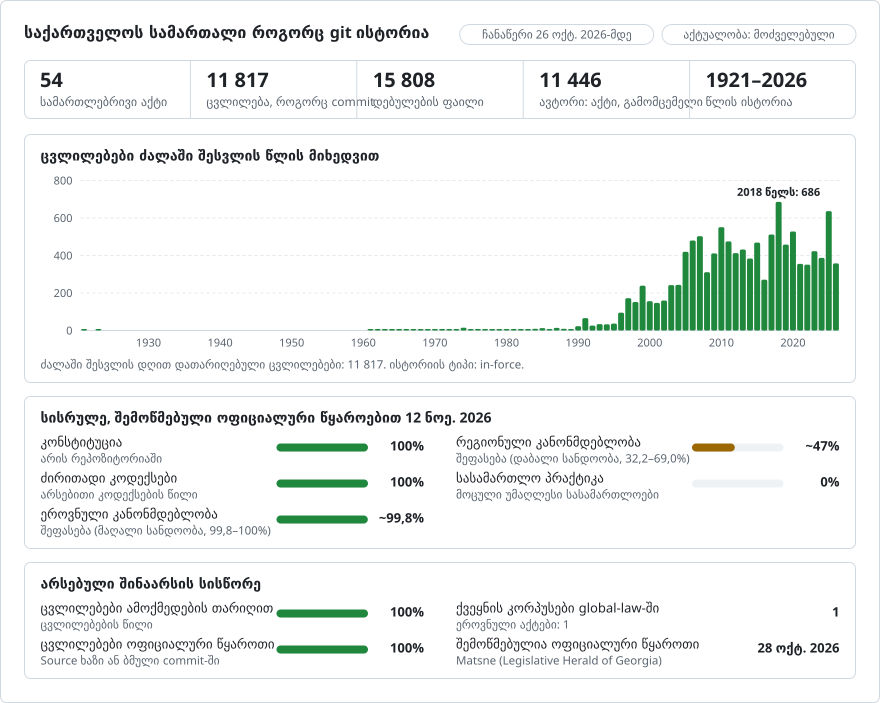

# საქართველოს კანონმდებლობა, ცვლილება ცვლილებით

**ქართული** · [English](README.en.md)

<picture>
<source media="(prefers-color-scheme: dark)" srcset="data/ka/effort-dark.svg">

</picture>

ეს რეპოზიტორია [lexifina/global-law](https://github.com/lexifina/global-law)-ის ნაწილია, რომელიც ყველა ქვეყნის სამართლის ერთიანი git-ისტორიაა: აქ არის საქართველოს ეროვნული კანონმდებლობა, რომელსაც global-law კითხულობს საქაღალდიდან `georgia/national/acts/`.

საქართველოს კანონები git-რეპოზიტორიის სახით: 948 აქტი [მაცნედან](https://matsne.gov.ge), ანუ საქართველოს საკანონმდებლო მაცნიდან, ქართული კანონმდებლობის ოფიციალური გამომცემლისგან. ესაა ყველა დოკუმენტი, რომელსაც მაცნე „კანონის“ ჯგუფში ძირითად (კონსოლიდირებულ) დოკუმენტად ასახელებს, ძალაშია თუ არა: 796 კანონი; ავტონომიური რესპუბლიკების (აჭარა, აფხაზეთი) 57 კანონი; 40 ორგანული კანონი; 36 კოდექსი; „კანონის“ ჯგუფის 12 სხვა აქტი (საბჭოთა პერიოდის დეკრეტები და მსგავსი); პარლამენტის 4 რეგლამენტი; 2 კონსტიტუცია (1995 წლისა და 1921 წლის კონსტიტუცია, როგორც მას მაცნე აქვეყნებს); 1 კონსტიტუციური კანონი. თითოეულ კანონს ერთი საქაღალდე აქვს, თითოეულ მუხლს კი ერთი ფაილი. ყოველი ცვლილება არის კომიტი, რომელიც მიეწერება მის შემტან აქტს და დათარიღებულია იმ დღით, როდესაც ეს აქტი ძალაში შევიდა, თბილისის დროით შუადღეს. ტექსტი ქართული ორიგინალია, როგორც მას მაცნე აქვეყნებს.

ისტორია მოიცავს პერიოდს 1921-02-21-დან 2026-10-26-მდე: 11 818 კომიტი `main`-ზე, აგებული 12 954 კონსოლიდირებული პუბლიკაციიდან. კიდევ 58 კომიტი, იმ ცვლილებებისთვის, რომლებიც უკვე გამოქვეყნდა, მაგრამ ძალაში 2026-10-28-ის შემდეგ შედის, არის შტოზე `future`, რომელიც არასოდეს შეირწყმება.

კანონქვემდებარე აქტები (ბრძანებულებები, დადგენილებები, ბრძანებები: მაცნეზე კიდევ დაახლოებით 50 000 დოკუმენტი) ჯერ არ არის შეტანილი.

## იურისტის კითხვები git-ის ბრძანებებად

თითოეული კანონის საქაღალდეა `<kind>/<Matsne id>/`, რომელიც სათაურთან ერთად ჩამოთვლილია ფაილში [`laws.csv`](laws.csv): მაგალითად, `constitution/30346` (კონსტიტუცია), `code/1043717` (საგადასახადო კოდექსი), `code/31702` (სამოქალაქო კოდექსი), `code/16426` (სისხლის სამართლის კოდექსი).

| კითხვა | ბრძანება |
| --- | --- |
| რას ამბობდა კონსტიტუციის 37-ე მუხლი 2019 წლის 1 იანვარს? | `python tools/in_force_on.py 2019-01-01 constitution/30346 37` |
| მთლიანი კანონი მოცემული თარიღისთვის | `python tools/in_force_on.py 2019-01-01 constitution/30346` |
| იგივე, უკვე გამოქვეყნებული, მაგრამ ჯერ ძალაში შეუსვლელი ცვლილებების გათვალისწინებით | `python tools/in_force_on.py --future 2027-01-01 code/1043717 1` |
| რომელმა აქტმა შეცვალა ბოლოს მუხლის თითოეული სტრიქონი? | `git blame code/31702/1.md` |
| მუხლის ყველა ცვლილება, მის უკან მდგომი აქტის მითითებით | `git log -p code/1043717/12-1.md` |
| შეცვლილი სიტყვები და არა მთლიანი სტრიქონები | `git log -p --word-diff code/1043717/12-1.md` |
| ყველაფერი, რაც ერთმა აქტმა შეცვალა | `git log --author='№6500-რს' --stat` |
| ყველა აქტი, რომელმაც კანონი შეცვალა, თანმიმდევრობით | `git log --format='%(trailers:key=In-force,valueonly,separator=) %an' -- code/1043717` |
| კომიტები მოცემული დღის ჩათვლით, დროის სარტყლის მოულოდნელობების გარეშე | `git log --before='2019-01-01T23:59:59+04:00' -1 -- constitution/30346` |
| ის, რაც არცერთ აქტს არ მიეწერება | `git log --grep='Kind: unexplained'` |
| კანონების სია და ცვლილების შემტანი აქტების სია მათი ძალაში შესვლის თარიღებით | [`laws.csv`](laws.csv), [`data/acts.csv`](data/acts.csv) |

PowerShell-ში `git show $(...):path` ორ არგუმენტად იყოფა; გამოიყენეთ `$r = git rev-list -1 main -- code/31702; git show "$($r):code/31702/1.md"`.

მუხლების ფაილები ნომრით არის დასახელებული: `12-1.md` არის მუხლი 12¹ (`მუხლი 12¹`). მეორე მუხლი, რომლის ნომერიც იმავე კანონში უკვე გამოყენებულია (დანართი, ციტირებული ტექსტი), იღებს `~2`-ს. თითოეული ფაილი იწყება მუხლის ზემოთ მდგომი წიგნის, ნაწილის ან თავის სათაურებით, თუ ასეთი არსებობს, `##` სტრიქონების სახით, შემდეგ მოდის მუხლის სათაური `# მუხლი 12¹. ...` სახით, შემდეგ კი თითო სტრიქონი თითოეული პუნქტისთვის. მაცნე შეცვლილი ტექსტის ქვეშ ბეჭდავს შენიშვნას, რომელშიც დასახელებულია ის აქტი, რომელმაც ტექსტი ბოლოს შეცვალა (`საქართველოს 2019 წლის 28 ივნისის კანონი №4906 - ვებგვერდი, 04.07.2019წ.`); ეს შენიშვნები შენარჩუნებულია იქ, სადაც გვხვდება, `- ` სტრიქონების სახით. `title.md` შეიცავს სათაურსა და პრეამბულას, `signature.md` ხელმოწერის ბლოკს, ხოლო `changes-listed.md` ცვლილებათა ჩამონათვალს, რომელსაც ზოგიერთი ძველი კანონი ბოლოში ბეჭდავს.

## თარიღები და რომელს ვიყენებთ

მაცნე თითოეულ კანონს აქვეყნებს კონსოლიდირებული პუბლიკაციების სერიის სახით. N-ე პუბლიკაცია არის ტექსტი კანონის ცვლილებათა სიაში N-ე ცვლილების შემდეგ, და მაცნე მას ათარიღებს ცვლილების შემტანი აქტის **მიღების** დღით. ეს არც გამოქვეყნების დღეა და არც ძალაში შესვლის დღე.

**კომიტები დათარიღებულია ცვლილების ძალაში შესვლის დღით.** ეს თარიღი იკითხება ცვლილების შემტანი აქტის საკუთარი ამოქმედების მუხლიდან მაცნეზე:

- „ეს კანონი ამოქმედდეს გამოქვეყნებისთანავე“: გამოქვეყნების თარიღი. 6 003 კომიტი.
- „გამოქვეყნებიდან მე-15 დღეს“ (გამოქვეყნებიდან N-ე დღეს): გამოქვეყნების თარიღს დამატებული N დღე, რადგან დღეებით განსაზღვრული ვადა მოვლენის მომდევნო დღიდან აითვლება. 1 215 კომიტი.
- აქტში მითითებული თარიღი („2021 წლის 1 მარტიდან“): ეს თარიღი. 2 646 კომიტი.
- თარიღის ნაცვლად მოვლენა (სხვა კანონის ამოქმედება, პრეზიდენტის ფიცი), ან ამოქმედების მუხლი ვერ მოიძებნა: გამოქვეყნების თარიღი, აღნიშნული როგორც `In-force-basis: published (...)`, აქტის სიტყვების ციტირებით. 1 006 კომიტი.

ცვლილების ყოველ კომიტს აქვს `In-force:`, `In-force-basis:`, `In-force-rule:` (აქტის სიტყვები), `Adopted:` და `Published:`. როდესაც აქტის ნაწილები ძალაში სხვა თარიღებში შედის („1. ეს კანონი, გარდა ამ კანონის პირველი მუხლისა, ამოქმედდეს გამოქვეყნებისთანავე. 2. ამ კანონის პირველი მუხლი ამოქმედდეს 2025 წლის 1 სექტემბრიდან.“), კომიტი თარიღდება აქტის ძირითადი დებულებით, ხოლო დანარჩენი ნაწილები ჩამოთვლილია `In-force-part:` სტრიქონებად. **ასეთ კომიტში ტექსტი ამ ნაწილებსაც მოიცავს ძირითადი თარიღიდან**, რადგან მაცნეს კონსოლიდირებული ტექსტი მათ ერთმანეთისგან არ გამოყოფს.

აქტები ძალაში შედის არა გამოქვეყნების თანმიმდევრობით (ნოემბერში მიღებული აქტი შეიძლება ძალაში შევიდეს 1 იანვარს, დეკემბერში მიღებული და დაუყოვნებლივ ამოქმედებული აქტის შემდეგ). ცვლილებები გამოიყენება ძალაში შესვლის თანმიმდევრობით. როდესაც მოგვიანებით გამოქვეყნებული ცვლილება ეხება სტრიქონებს, რომლებსაც ეხება ადრე გამოქვეყნებული, ჯერ ძალაში შეუსვლელი ცვლილებაც, ის ხელახლა გამოიყენება იმ დროს მოქმედ ტექსტზე სამმხრივი სტრიქონული შერწყმით. როდესაც ეს შეუძლებელია, ცვლილება შეჩერებულია, სანამ ადრინდელი აქტი ძალაში არ შევა, და ჩნდება ამ აქტის კომიტში; ორივე კომიტი ამას აღნიშნავს (`Held-back:` და `Includes-held-back:`, სულ 1 829 ფაილი).

აქტი, რომელიც ძალაში შევიდა იმ კანონზე ადრე, რომელსაც ცვლის (კანონი, რომელიც შეიცვალა მიღებასა და ძალაში შესვლას შორის), თარიღდება კანონის ძალაში შესვლის დღით, ხოლო აქტის საკუთარი თარიღი მითითებულია როგორც `In-force-act:`.

თითოეული კანონის პირველი კომიტი (`Kind: original`) არის მაცნეს 0 პუბლიკაცია: კანონი მიღებული სახით, დათარიღებული მისივე ამოქმედების მუხლით.

**Git-ს არ შეუძლია 1970 წლამდელი თარიღების შენახვა.** მანამდელი კანონები (საბჭოთა პერიოდის კოდექსები და დეკრეტები) დაკომიტებულია 1970-01-01-ით, ერთმანეთისგან ერთი წამის ინტერვალით და თანმიმდევრობით. ნამდვილი თარიღი არის `In-force:` ტრეილერში, რომელსაც `tools/in_force_on.py` კითხულობს.

## რას ნიშნავს „ავტორი“

კომიტის ავტორი არის აქტი, რომელმაც ცვლილება შეიტანა, ისე, როგორც მას მაცნე ასახელებს, მისამართით, რომელიც ვერ იარსებებს: `საქართველოს კანონი №4906 (28.06.2019) <law-4906-20190628@matsne.invalid>`. სახელი შედგება აქტის სახის, ნომრისა და მიღების თარიღისგან; მისამართი კი მისი ნომრისგან (ტრანსლიტერირებული) და მიღების თარიღისგან. ამიტომ `git blame` თითოეული სტრიქონისთვის ასახელებს აქტს, რომელმაც ის ბოლოს დაწერა. კანონის პირველი კომიტის ავტორი თავად კანონია.

ცვლილება აქტს მიეწერება თავად მაცნეს მონაცემების საფუძველზე: კანონის N-ე პუბლიკაცია არის ტექსტი მის ცვლილებათა სიაში N-ე ცვლილების შემდეგ, ხოლო ეს სია ცვლილების შემტან აქტზე ბმულს შეიცავს (`Evidence: matsne`). კომიტის 10 769 ნაწილში შეცვლილ ტექსტს ასევე ემატება მაცნეს დაბეჭდილი შენიშვნა ამ აქტის ნომრით (`Evidence: matsne + note`); 461 ნაწილში არ ემატება (ამოღება შენიშვნას არ ტოვებს, ძველ პუბლიკაციებში კი შენიშვნები ნაკლებია). ორ პუბლიკაციას შორის განსხვავება, რომლისთვისაც მაცნე არცერთ აქტს არ ასახელებს, იქნებოდა გამომცემლის კომიტი ნიშნით `Kind: unexplained`; ასეთი კომიტების რაოდენობაა 0.

სულ: 947 ორიგინალური ტექსტი, ცვლილების 10 583 კომიტი და 287 ძალადაკარგულად გამოცხადება, 10 866 ცვლილების შემტანი აქტით.

## რას არ აჩვენებს

- კანონქვემდებარე აქტებს (პრეზიდენტის ბრძანებულებებს, მთავრობის დადგენილებებს, მინისტრის ბრძანებებს), საერთაშორისო ხელშეკრულებებსა და სასამართლო გადაწყვეტილებებს, გარდა იმ შემთხვევებისა, როდესაც ისინი ცვლილების შემტან აქტებად გვევლინება. საკონსტიტუციო სასამართლოს გადაწყვეტილებები, რომლებითაც დებულებები არაკონსტიტუციურად არის ცნობილი, მიეწერება როგორც ტექსტის შემცვლელი აქტი.
- ინგლისურ თარგმანებს. მაცნე ბევრი კანონის არაოფიციალურ ინგლისურ თარგმანს აქვეყნებს; ავთენტურია მხოლოდ ქართული ტექსტი და აქ მხოლოდ ის გამოიყენება.
- აქტის რომელი ნაწილები შევიდა ძალაში მისი ძირითადი დებულების შემდეგ, `In-force-part:` სტრიქონების გარდა (იხ. ზემოთ).
- გარდამავალ ნორმებსა და მოქმედების შენარჩუნების ნორმებს, რომლებიც ცვლილების შემტან აქტებშია, თითოეული კომიტის `Source:` ბმულზე.
- ძალადაკარგულად გამოცხადებებს, რომლებსაც მაცნე კანონის ცვლილებათა სიაში ჩანაწერის გარეშე აღრიცხავს. მაცნეზე 441 კანონი აღარ არის ძალაში; მათი ფაილები წაიშლება იმ დღეს, როდესაც გამაუქმებელი აქტი ძალაში შევიდა, თუ მაცნე ამ აქტს კანონის ბოლო ცვლილებად ასახელებს, სხვა შემთხვევაში კი რჩება ბოლო გამოქვეყნებული სახით (იხ. `status` ფაილში `laws.csv`).
- სქოლიოებს, სურათების სახით განლაგებულ ცხრილებსა და ფორმატირებას. ცხრილები შენარჩუნებულია სტრიქონებად, რომელთა უჯრები `|`-ით არის გამოყოფილი.
- პუბლიკაციებს, რომელთა წაკითხვაც ვერ მოხერხდა: 0, ჩამოთვლილია ფაილში [`data/issues.csv`](data/issues.csv).

ეს არის კვლევითი დამხმარე საშუალება. ოფიციალურია მხოლოდ საქართველოს საკანონმდებლო მაცნის მიერ გამოქვეყნებული ტექსტები, ხოლო მაცნეს კონსოლიდირებული ვერსიები, და შესაბამისად ეს რეპოზიტორიაც, ცვლილების შემტანი აქტების ოფიციალური პუბლიკაცია არ არის.

## როგორ მოწმდება

- `tools/in_force_on.py` შერჩეული მუხლებისა და თარიღებისთვის იძლევა იმავე ტექსტს, რასაც მაცნეს საკუთარი კონსოლიდირებული პუბლიკაცია ამ თარიღისთვის (იხ. REPRODUCE.md).
- კანონის ყველა ცვლილების თანმიმდევრული გამოყენება იძლევა მის უახლეს პუბლიკაციას მაცნეზე, ყველა კანონისთვის, გარდა 0 კანონისა (ჩამოთვლილია `data/issues.csv`-ში).
- ყოველი კომიტის ტრეილერები იკითხება `git interpret-trailers --parse`-ით. `main`-ში შერწყმები (merge) არ არის, და მისი თარიღები არასოდეს ბრუნდება უკან და არ სცდება აგების დღეს.
- აგება დეტერმინისტულია: იმავე გვერდებიდან იძლევა კომიტების იმავე ჰეშებს. ყოველი გვერდის sha256 არის ფაილში [`data/page-sha256.tsv`](data/page-sha256.tsv). იხ. [`REPRODUCE.md`](REPRODUCE.md).

## როგორ იქმნება

ისტორია ეყრდნობა მაცნეს საძიებო ჩამონათვალს „კანონის“ ჯგუფის ყველა ძირითადი დოკუმენტისთვის, თითოეული კანონის გვერდს, სადაც ჩამოთვლილია მისი კონსოლიდირებული პუბლიკაციები და ცვლილებები ცვლილების შემტან აქტებზე ბმულებით, ასევე ყველა პუბლიკაციასა და ცვლილების შემტან ყველა აქტს. `parse_doc.py` თითოეულ პუბლიკაციას კითხულობს სათაურად და მუხლებად. `inforce.py` კითხულობს თითოეული აქტის ამოქმედების მუხლს. `build.py` ადარებს ერთმანეთის მომდევნო პუბლიკაციებს მუხლ-მუხლ, ზემოთ აღწერილი წესით აკუთვნებს და ათარიღებს თითოეულ ცვლილებას და წერს ისტორიას ერთი ნაკადური `git fast-import`-ით. მის აგებასა და შემოწმებაში ხელოვნური ინტელექტის არცერთი მოდელი არ მონაწილეობს.

## ლიცენზია

წყარო: სსიპ "საქართველოს საკანონმდებლო მაცნე", https://matsne.gov.ge. ტექსტები გარდაიქმნა თითო ფაილად თითოეული მუხლისთვის და დალაგდა კომიტებად; ფორმულირება არ შეცვლილა. საქართველოს კანონის „საავტორო და მომიჯნავე უფლებების შესახებ“ (მე-8 მუხლი) თანახმად, ოფიციალური დოკუმენტები, როგორიცაა კანონები და სხვა ნორმატიული აქტები, საავტორო უფლების ობიექტს არ წარმოადგენს; მაცნეს ვებგვერდზე თავად ვებგვერდთან მიმართებით მითითებულია „ყველა უფლება დაცულია“. **სანამ ეს რეპოზიტორია საჯარო გახდება, გადაამოწმეთ მაცნეს პირობები.** Lexifina-ს საკუთარი წვლილი (ინსტრუმენტები, სტრუქტურა და კომიტების შეტყობინებები) ვრცელდება CC0-ის პირობებით. იხ. [`LICENSE`](LICENSE).

ეს არის ინგლისური ვერსიის ([README.en.md](README.en.md)) თარგმანი; განსხვავების შემთხვევაში უპირატესობა ინგლისურ ვერსიას აქვს.

## მეტი

რეპოზიტორიიდან [lexifina/global-law](https://github.com/lexifina/global-law) (ინგლისურად):

- [FEATURES.md](https://github.com/lexifina/global-law/blob/main/FEATURES.md): ყველა ფუნქცია და რა უნდა უზრუნველყოს თითოეულმა კორპუსმა (`git blame`, `law.py`, MCP ინსტრუმენტები)
- [FAQ.md](https://github.com/lexifina/global-law/blob/main/FAQ.md): კითხვები და პასუხები · [CONTRIBUTING.md](https://github.com/lexifina/global-law/blob/main/CONTRIBUTING.md): ცვლილებების შეთავაზება · [MCP.md](https://github.com/lexifina/global-law/blob/main/MCP.md): MCP სერვერი · [REPRODUCE.md](https://github.com/lexifina/global-law/blob/main/REPRODUCE.md): როგორ შეიქმნა · [CHANGELOG.md](https://github.com/lexifina/global-law/blob/main/CHANGELOG.md)
- [FRESHNESS.md](https://github.com/lexifina/global-law/blob/main/FRESHNESS.md): რამდენად აქტუალურია თითოეული კორპუსი · [მონიტორინგი](https://github.com/lexifina/global-law/tree/main/monitoring): მუშაობს თუ არა განახლებები · [WATCHING.md](https://github.com/lexifina/global-law/blob/main/WATCHING.md): როგორ მოწმდება თითოეული ოფიციალური წყარო ცვლილებებზე
- [performance/](https://github.com/lexifina/global-law/tree/main/performance): რამდენად სწრაფია ინსტრუმენტები, გაზომილი
- [visualisations/](https://github.com/lexifina/global-law/tree/main/visualisations): დიაგრამები და კავშირები მთელი მსოფლიოს სამართალში
- [მოწყვლადობები](https://github.com/lexifina/global-law/tree/main/vulnerabilities): შეცდომები აქტებში, როგორც ისინი გამოქვეყნდა
